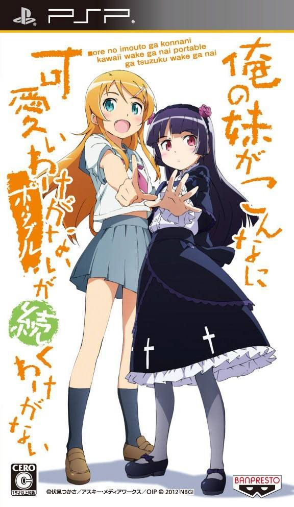
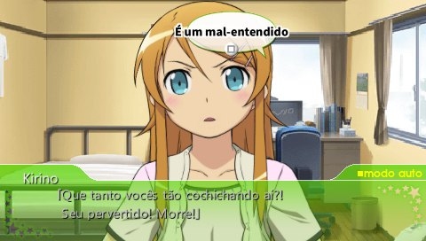
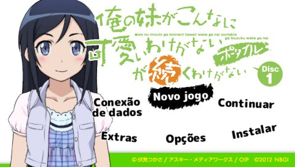
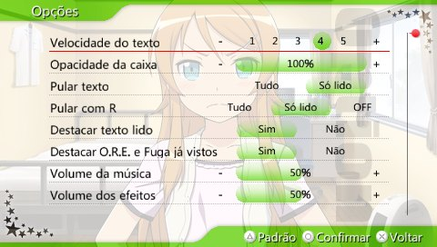
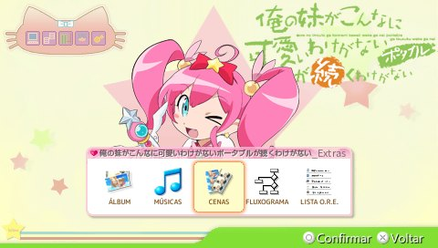

# Oreimo Portable PT-BR

**Tradução brasileira de fãs da visual novel de PSP _Ore no Imouto ga Konna ni Kawaii Wake ga Nai Portable ga Tsuzuku Wake ga Nai_.** 
Feita direto do japonês, com as vozes e músicas originais preservadas.

## 💿 Estado dos discos

### DISCO 1 — DISPONÍVEL

Tradução, testes técnicos e conferência manual concluídos no PPSSPP. **ISO disponível para download no Internet Archive.**

### DISCO 2 — INDISPONÍVEL / AINDA NÃO INICIADO

A tradução do segundo disco ainda não começou. Não há previsão.

## 📥 Download

**[BAIXAR DISCO 1 — PT-BR](https://archive.org/download/oreimo-portable-ga-tsuzuku-ptbr/Oreimo_Disco1_PTBR.iso)**

Arquivo: `Oreimo_Disco1_PTBR.iso` · Tamanho: aproximadamente 1,5 GB · Hospedagem: Internet Archive.

Plataforma: PSP · Emulador: PPSSPP · Textos: Português brasileiro · Áudio: Japonês.

## 🕹️ Como jogar

1. Baixe a ISO do Disco 1.
2. Abra o PPSSPP.
3. Selecione a ISO baixada e comece a jogar.

## 🎮 Imagens da tradução

 
 

## 🌐 Site oficial

**[solisfeeld.github.io/oreimo-portable-ptbr](https://solisfeeld.github.io/oreimo-portable-ptbr/)**

## ✨ Conteúdo traduzido

| | Disco 1 |
|---|---|
| **Diálogos** | 299 cenas e 18.852 unidades de texto, com todas as rotas e os extras |
| **Falas recuperadas** | A estrutura segue o original japonês, o que recupera as falas cortadas no patch inglês |
| **Interface** | Menus, Opções, Histórico, Lista O.R.E., Fluxograma, Álbum e comentários do modo Barrage |
| **Imagens com texto** | 362 recursos, incluindo os 242 balões de réplica da Conversa a Dois, refeitos no estilo do original |
| **Vídeos** | Legendas em português nos 2 vídeos que precisavam |
| **Áudio** | Vozes e músicas japonesas originais |

## 📖 Sobre o projeto

*Oreimo Portable* (俺の妹がこんなに可愛いわけがない ポータブルが続くわけがない) é uma visual novel para PSP lançada em 2012, em 2 discos. Esta fan translation é um projeto independente, sem fins comerciais, com uma tradução nova **a partir do japonês**: fiel ao original, natural em português e com o humor e o jeito de falar de cada personagem.

**Plataforma:** PSP · **Emulador:** PPSSPP

## ❓ Perguntas frequentes

<strong>Já posso jogar em português?</strong>

 
Sim. [Baixe a ISO do Disco 1](https://archive.org/download/oreimo-portable-ga-tsuzuku-ptbr/Oreimo_Disco1_PTBR.iso) e abra no PPSSPP.

<strong>Tem data de lançamento?</strong>

 
O Disco 1 já está disponível. A tradução do Disco 2 ainda não foi iniciada e não tem previsão de lançamento.

<strong>Funciona no celular ou num PSP de verdade?</strong>

 
Não sabemos, porque isso ainda não foi testado.

Mais perguntas no [site](https://solisfeeld.github.io/oreimo-portable-ptbr/#perguntas).

## 📜 Créditos e avisos legais

Projeto independente de fãs, sem fins comerciais, sem vínculo com os titulares da obra. *Ore no Imouto ga Konna ni Kawaii Wake ga Nai Portable ga Tsuzuku Wake ga Nai* © Tsukasa Fushimi / ASCII Media Works / OIP, ©2012 NBGI.

[Créditos completos](docs/CREDITOS_E_AVISOS.md) · [Licenças](docs/LICENCAS.md) · [Histórico de versões](CHANGELOG.md) · [Documentação técnica](docs/FERRAMENTAS.md)
