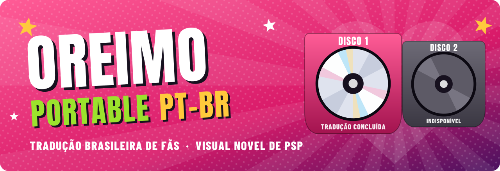

<div align="center">



# Oreimo Portable PT-BR

**Tradução brasileira de fãs da visual novel de PSP _Ore no Imouto ga Konna ni Kawaii Wake ga Nai Portable ga Tsuzuku Wake ga Nai_.**<br>
Feita direto do japonês, com as vozes e músicas originais preservadas.

### [🌐 Abrir o site oficial do projeto](https://solisfeeld.github.io/oreimo-portable-ptbr/)

[**Downloads**](#-download-e-instalação) · [**Instalação**](#-download-e-instalação) · [**Compatibilidade**](#-compatibilidade-com-ppsspp) · [**Perguntas**](#-perguntas-frequentes) · [**Documentação**](#-documentação-técnica-e-ferramentas)

</div>

## 💿 Estado dos discos


### DISCO 1 — TRADUÇÃO CONCLUÍDA

Tradução, testes técnicos e conferência manual concluídos no PPSSPP. A versão traduzida existe só localmente, no projeto: **ainda não há arquivo de instalação público.**


### DISCO 2 — INDISPONÍVEL / AINDA NÃO INICIADO

A tradução do segundo disco ainda não começou. Não há previsão.

## 📥 Download e instalação

> [!IMPORTANT]
> **Patch público do Disco 1 em preparação.** Ainda não dá para jogar em português a partir deste repositório. Não há data.

| pergunta | resposta |
|---|---|
| **O que dá para baixar hoje?** | Só as ferramentas e a documentação. Elas são para quem programa, **não traduzem o jogo**. |
| **Onde baixar?** | Na [versão v0.1.0-disc1](https://github.com/Solisfeeld/oreimo-portable-ptbr/releases/tag/v0.1.0-disc1). |
| **O que será preciso para jogar?** | Sua própria cópia original do jogo, o patch do Disco 1 quando for publicado e o PPSSPP. |
| **Como instalar?** | Ainda não há o que instalar. A meta é um processo guiado: selecionar a sua cópia do jogo e gerar a versão em português, sem programação. |
| **Como jogar no PPSSPP?** | Quando o patch sair, é só abrir a ISO gerada no PPSSPP. |

Quer entender a demora? [Veja por que um patch comum não pode ser publicado](docs/PATCH.md).

**Este repositório nunca vai distribuir a ISO do jogo nem indicar onde obtê-la.** Não publique nem peça ISOs, arquivos extraídos ou links para cópias do jogo nas issues.

## 🎮 Imagens da tradução

<div align="center">


*Ilustração criada para o projeto, com frases próprias. **Não é captura do jogo.***
</div>

Capturas reais não são publicadas aqui porque mostram arte protegida do jogo. Por decisão do projeto, o repositório não traz imagens do jogo.

## ✨ Conteúdo traduzido

| | Disco 1 |
|---|---|
| **Diálogos** | 299 cenas e 18.852 unidades de texto traduzidas e revisadas, com todas as rotas e os extras |
| **Falas recuperadas** | A estrutura segue o original japonês, o que recupera as cerca de 36 falas de uma cena cortadas no patch inglês |
| **Interface** | Menus, Opções, Histórico, Lista O.R.E., Fluxograma, Álbum, títulos de cena e comentários do modo Barrage |
| **Imagens com texto** | 362 recursos, incluindo os 242 balões de réplica da Conversa a Dois, cut-ins e ícones O.R.E., refeitos no estilo do original |
| **Vídeos** | Legendas em português nos 2 vídeos que precisavam, com o áudio original preservado |
| **Áudio** | Vozes e músicas japonesas originais, sem alteração |
| **Texto na tela** | Quebra pela largura real da fonte, novas caixas quando a fala não cabe, acentos também no Álbum e Histórico sem palavras cortadas |

## 🕹️ Compatibilidade com PPSSPP

| ambiente | situação |
|---|---|
| PPSSPP 1.20.4, flatpak, Linux | testado por automação |
| Outras versões do PPSSPP, Windows, macOS, Android | não testado |
| PSP real | não testado |

Os testes usaram a versão de trabalho do projeto, que não é distribuída. [Veja os resultados completos](docs/COMPATIBILIDADE.md).

### Limitações conhecidas

* **Falas dubladas divididas em 2 caixas (50 casos):** se você avançar para a segunda caixa antes de a voz acabar, a voz é cortada, porque o motor do jogo corta a voz em todo avanço. Basta esperar a voz terminar.
* **Créditos finais em japonês:** mantidos assim por decisão do projeto.
* **Ícones de palavra-chave:** parte da arte fica em japonês de propósito, como placas, logotipos e textos que fazem parte da ilustração.
* **BOA♥ e RUIM!:** as imagens estão prontas e o motor aceita o formato usado, mas o uso real não foi reproduzido, pois depende de uma opção liberada com progresso.
* **Aviso de autossalvamento:** traduzido, mas não apareceu nos testes.
* **Minijogo e balões amarelos:** traduzidos, mas não localizamos nenhum caminho que os mostre no Disco 1.

## 📖 Sobre o projeto

*Oreimo Portable* (俺の妹がこんなに可愛いわけがない ポータブルが続くわけがない) é uma visual novel para PSP lançada em 2 discos. Esta fan translation é um projeto independente, sem fins comerciais, que busca oferecer o jogo em português do Brasil com uma tradução nova **a partir do japonês**.

O objetivo é ser fiel ao original e natural em PT-BR, preservando o humor, o registro e o jeito de falar de cada personagem. Inglês e outras traduções serviram apenas como referência de comparação.

Próximos passos, sem data prevista:

1. Resolver o [patch público do Disco 1](docs/PATCH.md), sem incluir conteúdo protegido.
2. Iniciar o Disco 2.

## ❓ Perguntas frequentes

<details>
<summary><strong>Já posso jogar em português?</strong></summary>
<br>
Ainda não. A tradução do Disco 1 está concluída, mas o patch público está em preparação.
</details>

<details>
<summary><strong>Tem data de lançamento?</strong></summary>
<br>
Não. Nem o patch do Disco 1 nem o Disco 2 têm data prevista.
</details>

<details>
<summary><strong>Preciso instalar Python para jogar?</strong></summary>
<br>
Não. Python só é necessário para as ferramentas de desenvolvimento. A meta do patch é um processo simples, sem programação.
</details>

<details>
<summary><strong>Vocês enviam a ISO ou indicam onde baixar o jogo?</strong></summary>
<br>
Não. O projeto não distribui o jogo nem aponta para cópias dele. Use a sua própria cópia, obtida legalmente.
</details>

<details>
<summary><strong>Funciona no celular ou num PSP de verdade?</strong></summary>
<br>
Não sabemos, porque isso ainda não foi testado.
</details>

Mais perguntas no [site](https://solisfeeld.github.io/oreimo-portable-ptbr/#perguntas).

## 🏷️ Créditos e avisos legais

Projeto independente de fãs, sem fins comerciais. Não tem vínculo com os titulares da obra nem foi autorizado por eles. *Ore no Imouto ga Konna ni Kawaii Wake ga Nai Portable ga Tsuzuku Wake ga Nai* © Tsukasa Fushimi / ASCII Media Works / OIP, ©2012 NBGI.

* **Solisfeeld:** direção do projeto, decisões de tradução e de arte, revisão e conferência no jogo.
* **Claude Code (Anthropic), ferramenta de IA:** redação da tradução, das artes por script, do código, dos testes e da documentação, sob essa direção.

Créditos dos trabalhos de que o projeto depende e avisos legais completos em [docs/CREDITOS_E_AVISOS.md](docs/CREDITOS_E_AVISOS.md).

**Licenças:** código próprio em [MIT](LICENSE) e documentação própria em [CC BY 4.0](LICENSE-DOCS). O jogo, a tradução e `referencia/` **ficam fora** dessas licenças: veja [docs/LICENCAS.md](docs/LICENCAS.md).

## 🛠️ Documentação técnica e ferramentas

Esta parte é para quem desenvolve. **Quem só quer jogar não precisa dela.**

| documento | conteúdo |
|---|---|
| [docs/USO.md](docs/USO.md) | Passo a passo das ferramentas |
| [docs/FERRAMENTAS.md](docs/FERRAMENTAS.md) | Descrição de cada script |
| [docs/FORMATOS.md](docs/FORMATOS.md) | Formatos do jogo |
| [docs/COMPATIBILIDADE.md](docs/COMPATIBILIDADE.md) | Ambientes e resultados dos testes |
| [docs/PATCH.md](docs/PATCH.md) | Situação do patch público |
| [docs/LICENCAS.md](docs/LICENCAS.md) | Licenças, exceções e auditoria |
| [docs/ATUALIZAR_SITE.md](docs/ATUALIZAR_SITE.md) | Como atualizar o site |
| [CHANGELOG.md](CHANGELOG.md) | Histórico de versões |

**O que está disponível:**

* **Ferramentas que funcionam:** leitura de ISO, GPDA e texturas GIM, leitura e remontagem de scripts, tokenizador do `envpsp.dat`, grafo de cenas, comparação de ISOs, desmontador MIPS e automação isolada do PPSSPP.
* **Testes:** um que roda sem o jogo e outro que usa a sua cópia.
* **`site/`:** o código deste site.
* **`referencia/`:** o código de trabalho do projeto, só para estudo. Não executa aqui.

**O que não está disponível:** ISOs, patch, EBOOT, arquivos dos discos, músicas, vozes, vídeos, imagens do jogo, fontes, textos do jogo, a tradução, referências de terceiros e os módulos de terceiros usados no projeto.

**Requisitos:** Python 3.10 ou mais novo; Pillow para texturas; NumPy para comparar áudio; PPSSPP via flatpak para a automação.

```bash
python3 testes/teste_independente.py                       # não precisa do jogo
python3 ferramentas/explorar.py info "/caminho/da/sua/copia.iso"
```

As ferramentas e qualquer uso futuro exigem a sua própria cópia legalmente obtida.
